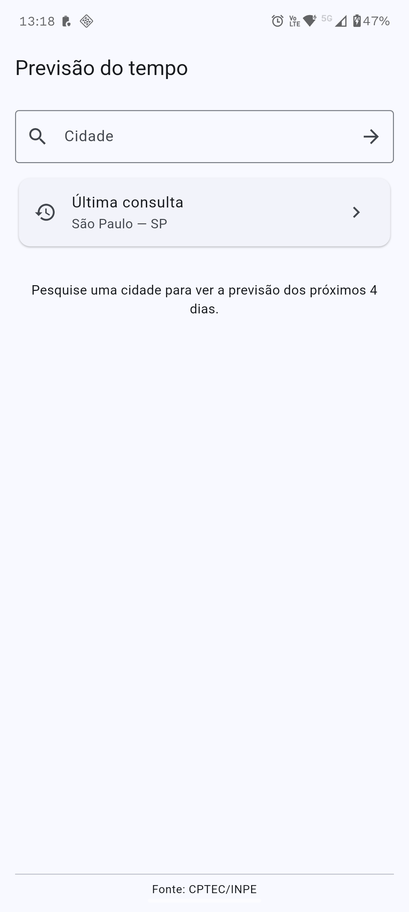
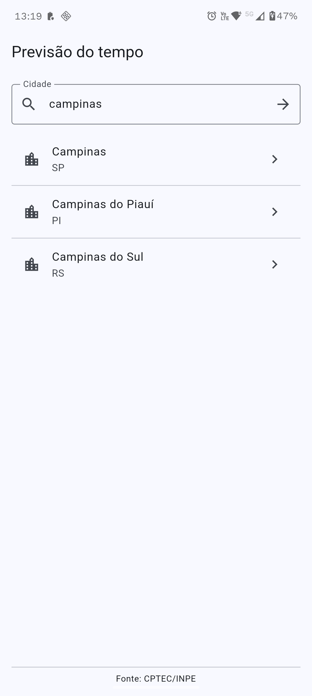
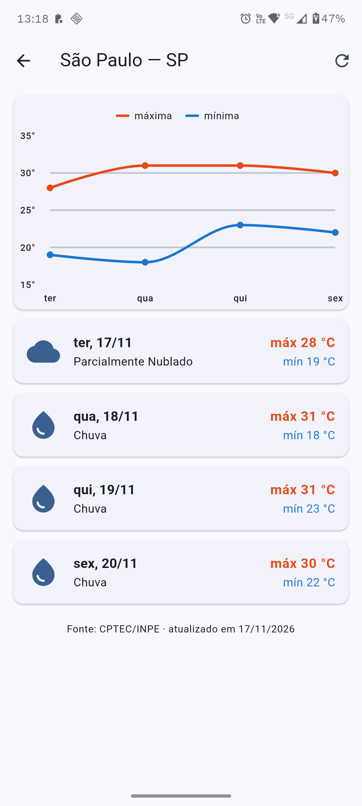
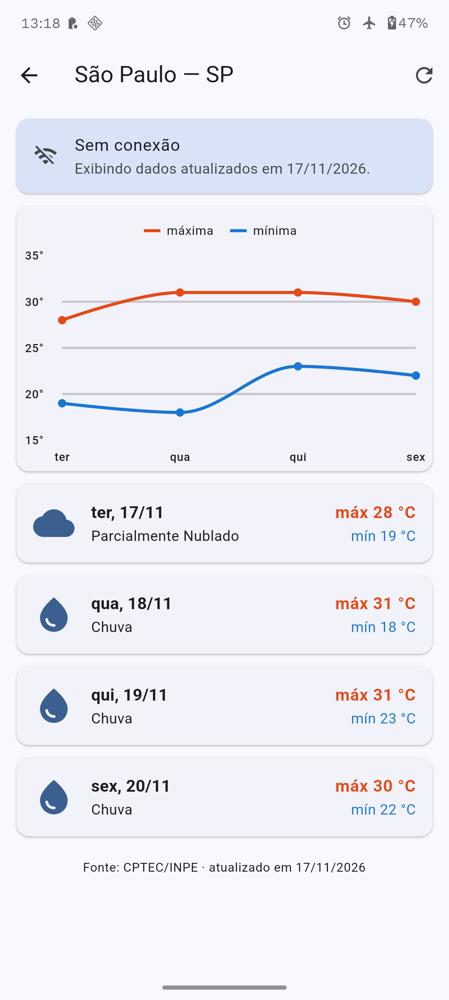
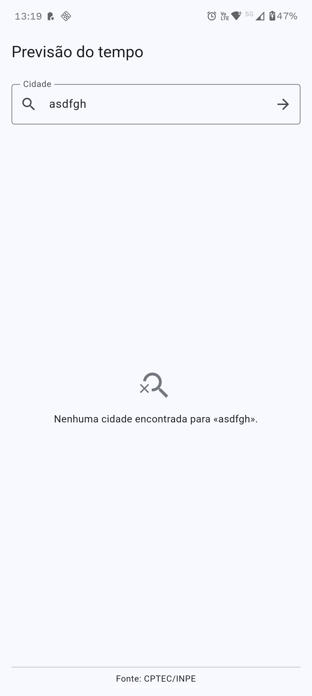

# Previsão do tempo

Atividade 2 — Previsão do tempo
Programação para Dispositivos Móveis I — Prof. Arley — Fatec

**Integrante: João Victor Lopes Rosa**

Aplicativo Flutter para Android que pesquisa cidades brasileiras e mostra a previsão
de 4 dias do CPTEC/INPE, com descrição e ícone da condição do tempo, índice
ultravioleta, gráfico de temperaturas e cache local da última consulta.

## Funcionalidades

- **Pesquisa de cidades** pelo nome, sem acento, listando nome e UF. A previsão usa o
  `id` devolvido pelo próprio serviço.
- **Previsão de 4 dias**, com todos os dias retornados pelo CPTEC/INPE: data,
  mínima e máxima em °C, condição do tempo, ícone, IUV (quando o serviço informa
  valor maior que zero — `0.0` é o que ele devolve quando não há estimativa) e a
  data de atualização informada pelo serviço.
- **Descrições legíveis** para as 40 siglas oficiais (`pn` → Parcialmente Nublado,
  `t` → Tempestade, `nv` → Nevoeiro, …), com fallback "Não definido".
- **Gráfico** de linhas com mínima e máxima dos dias que têm os dois valores.
- **Atualização** pelo botão da barra superior ou pelo gesto de puxar para baixo.
- **Cache local**: a última consulta é salva; sem internet o app mostra esses dados
  com aviso e a data de atualização, e a tela inicial oferece "Última consulta".
- **Tratamento de erros**: sem conexão, serviço indisponível, resposta inválida,
  nenhuma cidade encontrada e nenhuma previsão disponível têm mensagens próprias;
  campos ausentes não encerram o app.
- **Fonte identificada** no rodapé de todas as telas: CPTEC/INPE.

## Executar

Requisitos: Flutter 3.47.8 e Android SDK (API 36).

```sh
flutter pub get
flutter run
flutter build apk --debug
```

O APK fica em `build/app/outputs/flutter-apk/app-debug.apk`.

## Bibliotecas utilizadas

| Biblioteca | Versão | Uso |
| --- | --- | --- |
| `http` | 1.6.0 | requisições ao serviço do CPTEC/INPE |
| `xml` | 7.1.0 | leitura das respostas XML |
| `fl_chart` | 1.3.1 | gráfico de temperaturas |
| `shared_preferences` | 2.5.6 | cache local da última consulta |

Em desenvolvimento: `flutter_test` e `flutter_lints`.

## Persistência local

A última consulta (cidade + previsão) é gravada em `SharedPreferences` na chave
`ultima_consulta`, como um JSON com `cidade` e `previsao` (incluindo a data de
atualização do serviço). Ao abrir o app, a tela de busca oferece essa cidade; ao
abrir a previsão sem rede, o conteúdo salvo é exibido com o aviso "Sem conexão" e a
data dos dados. Não há dados pessoais, o backup do Android está desabilitado
(`allowBackup="false"`) e nada é enviado ao serviço além do termo pesquisado.

## Como o serviço é consumido

Base: `http://servicos.cptec.inpe.br/XML/` (documentação oficial em
<http://servicos.cptec.inpe.br/XML/>).

- `listaCidades?city=<nome sem acento>` → `cidades/cidade` com `nome`, `uf` e `id`.
- `cidade/{id}/previsao.xml` → `nome`, `uf`, `atualizacao` e até 4 nós `previsao`
  com `dia`, `tempo`, `maxima`, `minima` e `iuv`.

Detalhes tratados no código: a resposta é **ISO-8859-1** (decodificada como latin1,
senão os acentos quebram), o serviço usa **HTTP sem TLS** (cleartext liberado apenas
para `servicos.cptec.inpe.br` em `android/app/src/main/res/xml/network_security_config.xml`),
as requisições têm timeout de 15 s e `iuv`, `maxima`, `minima` e `dia` podem faltar.

## Estrutura do código

```
lib/
  main.dart                  MaterialApp, tema e TelaBusca
  previsao/
    modelos.dart             Cidade, PrevisaoDia, PrevisaoCidade (+ JSON do cache)
    cptec.dart               cliente HTTP, parse XML e erros tipados
    condicoes.dart           tabela das 40 siglas com descrição e ícone
    cache.dart               SharedPreferences: última consulta
    tela_busca.dart          pesquisa e seleção da cidade
    tela_previsao.dart       previsão, gráfico, atualização e estados de erro
    widgets.dart             card do dia, gráfico e aviso
```

## Verificar

```sh
dart format --output=none --set-exit-if-changed lib test
flutter analyze
flutter test
```

**28 testes** e `flutter analyze` sem problemas.

## Capturas de tela

Capturadas no motorola moto g86 5G (Android 16):

| Busca | Resultados |
| --- | --- |
|  |  |

| Previsão de 4 dias | Sem conexão (cache) | Nenhuma cidade encontrada |
| --- | --- | --- |
|  |  |  |
